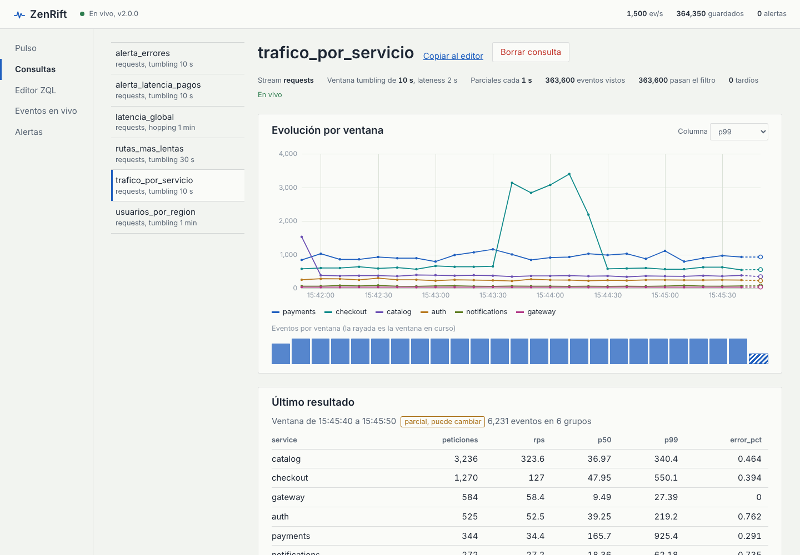

# ZenRift

Motor de analítica de eventos en tiempo real. Recibe eventos JSON por HTTP,
los guarda en un log en disco y ejecuta sobre ellos **consultas continuas** en
ZQL —SQL con ventanas de tiempo—, con alertas y un panel web en vivo. Es un
único binario en C++20 sin dependencias externas: servidor HTTP, almacenamiento,
compilador, motor de ventanas y panel están escritos desde cero.



```sql
SELECT service,
       count(*)                 AS peticiones,
       p99(latency_ms)          AS p99,
       avg(status >= 500) * 100 AS error_pct
FROM requests
GROUP BY service
WINDOW TUMBLING 10s
EMIT EVERY 1s
ALERT IF error_pct > 5 AND peticiones > 30 FOR 2 WINDOWS
```

## Qué hace

- **Ingesta HTTP** de NDJSON, arrays JSON o objetos sueltos: unos 800 000
  eventos/s en dos núcleos (ver [Rendimiento](#rendimiento)).
- **Log segmentado** por partición con CRC32C por registro, recuperación tras
  caídas (trunca colas rotas), retención por tamaño y antigüedad, y `fsync`
  configurable.
- **ZQL**: `WHERE`, `GROUP BY`, ventanas `TUMBLING` y `HOPPING` en tiempo de
  evento, `LATENESS`, `HAVING`, `ORDER BY`/`LIMIT`, resultados parciales con
  `EMIT EVERY` y alertas con `ALERT IF … FOR n WINDOWS`. Errores con línea y
  columna.
- **Agregaciones fusionables**, exactas o con error acotado: `count`, `sum`,
  `avg`, `min`/`max`, `stddev`, cuantiles con DDSketch (±1 %), distintos con
  HyperLogLog y top-k con Space-Saving.
- **Backfill**: una consulta puede empezar desde hace una hora o desde el
  principio del log y pasar a vivo sin perder ni duplicar eventos. Tras un
  reinicio, todas reconstruyen su estado desde el log.
- **Panel web incluido en el binario**: pulso del sistema, evolución de cada
  consulta ventana a ventana, editor ZQL que compila mientras escribes, eventos
  en vivo filtrados con ZQL y alertas. Tema claro y oscuro.
- **API REST + Server-Sent Events** para todo lo anterior.

## Inicio rápido

Requisitos: CMake 3.21+ y un compilador C++20 (probado con GCC 13 y Clang 18
en Linux).

```bash
cmake -S . -B build -DCMAKE_BUILD_TYPE=Release
cmake --build build -j
./build/zenrift serve --demo
```

Abre <http://127.0.0.1:7070>. La demo genera 1500 peticiones/s de una tienda
con microservicios (usuarios con distribución de Zipf, latencias
log-normales) y crea seis consultas de ejemplo. Cada dos minutos y medio un
servicio se degrada durante 45 s: verás subir su p99 y sus errores, saltar las
alertas y resolverse solas.

## Con tus datos

```bash
./build/zenrift serve                      # puerto 7070, datos en ./data

# Enviar eventos (NDJSON; el stream se crea solo)
curl -s localhost:7070/v1/streams/pedidos/events --data-binary @- <<'EOF'
{"ts": "2026-10-29T15:00:01Z", "tienda": "madrid", "importe": 42.5, "cliente": "c-81"}
{"ts": "2026-10-29T15:00:02Z", "tienda": "bilbao", "importe": 17.0, "cliente": "c-12"}
EOF

# Crear una consulta continua
curl -s localhost:7070/v1/queries -H 'Content-Type: application/json' -d '{
  "name": "ventas_por_tienda",
  "zql": "SELECT tienda, sum(importe) AS total, distinct(cliente) AS clientes FROM pedidos GROUP BY tienda WINDOW TUMBLING 1m",
  "from": "beginning"
}'

# Resultados: los últimos, o en vivo con SSE
curl -s 'localhost:7070/v1/queries/ventas_por_tienda/results?last=5'
curl -N localhost:7070/v1/queries/ventas_por_tienda/stream

# Lo que entra, filtrado en el servidor
curl -N 'localhost:7070/v1/streams/pedidos/tail?where=importe%20%3E%20100'

# Compilar sin crear: plan y diagnóstico
./build/zenrift check "SELECT tienda, p95(importe) FROM pedidos GROUP BY tienda"
```

Documentación:

- [docs/ZQL.md](docs/ZQL.md): el lenguaje, ventanas, tiempo de evento, alertas
  y la precisión de cada agregación.
- [docs/API.md](docs/API.md): todos los endpoints con ejemplos.
- [docs/ARQUITECTURA.md](docs/ARQUITECTURA.md): hilos, camino de un evento,
  formato del log, compilador, ventanas y recuperación.

## Cómo está hecho

```
 HTTP ──► hilo de red ──lote crudo──► shard (dueño de sus particiones)
          epoll/poll                   escáner → log → consultas → tails
              ▲                                │ paneles + marcas de agua
              │ respuestas, SSE                ▼
              └───────────────────────── coordinador
                                         finalizador, alertas, métricas, catálogo
```

- **Sin estado compartido**: cada partición tiene un único hilo dueño y todo
  cruza entre hilos como mensaje. El único cerrojo de la ingesta es el de la
  cola de mensajes, uno por lote de eventos.
- **Escáner con proyección**: el JSON se valida en una pasada y solo se
  extraen los campos que usa alguna consulta; el resto se salta sin
  interpretarlo.
- **ZQL compila a bytecode** para una VM de pila con lógica de tres valores,
  plegado de constantes y deduplicación de agregaciones.
- **Ventanas por paneles**: una ventana de 1 minuto que avanza cada 10 s es la
  fusión de seis paneles de 10 s; cada evento toca un solo panel.
- **Estructuras propias**: tabla hash Robin Hood, arenas, DDSketch,
  HyperLogLog, Space-Saving, CRC32C con SSE4.2, parser HTTP incremental.
- **Panel sin frameworks**: módulos ES nativos con tipos en JSDoc
  (`// @ts-check`), gráficas en Canvas 2D y Server-Sent Events.

## Rendimiento

Medido en un contenedor Linux con **2 vCPU**, compartidas con el propio
generador de carga: tómalo como orden de magnitud, no como techo.

De punta a punta (`zenrift loadgen`, HTTP + escáner + log + consultas, eventos
de ~224 bytes):

| Escenario | Rendimiento | Latencia por lote |
|---|---|---|
| Solo ingesta, 2 conexiones, lotes de 1000 | ~800 000 eventos/s (172 MB/s) | p50 1,2 ms · p99 6,8 ms |
| Con 3 consultas continuas activas | ~650 000 eventos/s | p50 1,8 ms · p99 8,6 ms |
| Ritmo fijo de 100 000 eventos/s, lotes de 500 | sostenido | p50 1,3 ms · p99 4,5 ms |

Piezas aisladas, un hilo (`zenrift_bench`):

| Pieza | Coste |
|---|---|
| Escáner NDJSON (valida y extrae 8 campos) | 526 ns/evento · 406 MB/s |
| Árbol JSON completo, para comparar | 1369 ns/evento |
| Filtro `WHERE` en la VM | 53 ns/evento |
| Consulta con `GROUP BY` + count + p99 + avg | 153 ns/evento |
| `DDSketch.add` · `HyperLogLog.add` | 11,7 ns · 6,4 ns |
| `FlatMap` (Robin Hood) vs `std::unordered_map`, insertar + buscar | 44,5 ns vs 82,5 ns |
| CRC32C con SSE4.2 · por software | 7,6 GB/s · 1,5 GB/s |
| `log.append` (CRC + búfer, sin fsync) · `log.read` | 232 ns · 75 ns por registro |

```bash
./build/zenrift_bench                                   # microbenchmarks
./build/zenrift loadgen --connections 2 --batch 1000    # contra un servidor en marcha
```

## Pruebas

```bash
cd build && ctest                                       # unitarias + integración
```

- **66 pruebas unitarias** (`tests/`, framework propio): estructuras de datos,
  JSON, sketches con sus cotas de error, compilador y VM, log con corrupción
  simulada, motor con reloj simulado, motor con hilos, parser y servidor HTTP.
- **17 pruebas de integración** (`tests/integration/run_integration.py`, solo
  biblioteca estándar de Python) contra el binario real: ingesta en todos los
  formatos, `chunked` y `100-continue`, resultados exactos por ventana, valores
  nulos, backfill, SSE, tail filtrado, alertas que se disparan y se resuelven,
  pipelining, errores y límites, autenticación, rutas peligrosas, reinicio con
  recuperación y un log con la cola rota por una caída.
- **Sanitizers**: todo lo anterior pasa limpio con AddressSanitizer +
  UndefinedBehaviorSanitizer (`-DZENRIFT_SANITIZE=address,undefined`) y con
  ThreadSanitizer (`-DZENRIFT_SANITIZE=thread`), también bajo carga con varios
  shards.
- **Panel**: `tsc -p jsconfig.json` comprueba los tipos JSDoc de todo
  `web/js` en modo estricto, sin errores.

## Configuración

`zenrift help` lista todos los ajustes. Se pasan como `--clave valor` o en un
archivo (`zenrift serve --config zenrift.conf`); hay uno comentado en
[zenrift.conf.example](zenrift.conf.example). Los más útiles:

| Ajuste | Por defecto | |
|---|---|---|
| `port`, `host` | `7070`, `127.0.0.1` | |
| `data_dir` | `./data` | |
| `fsync` | `interval` (1 s) | `always` para confirmar solo lo sincronizado |
| `retention`, `retention_bytes` | `7d`, `1GB` | por partición |
| `shards` | núcleos − 1 | hilos de proceso |
| `auth_token` | vacío | exige `Authorization: Bearer` en `/v1/` |
| `recovery_horizon` | `1h` | historia que se relee al arrancar |

## Estructura

```
src/
  core/      hash, tabla Robin Hood, arena, cola MPSC, CRC32C, tiempo, cadenas, registro
  json/      lexer con validación UTF-8, DOM y escritor
  sketch/    DDSketch, HyperLogLog, Space-Saving, momentos de Welford
  zql/       lexer, parser, AST, compilador, bytecode, VM, funciones
  storage/   archivos y log segmentado por partición
  engine/    escáner, paneles, consultas por partición, finalizador, alertas,
             catálogo, shards, coordinador
  net/       sockets, epoll/poll, waker, parser HTTP, servidor, router, cliente
  api/       rutas REST y SSE, panel embebido
  app/       configuración, serve, check, loadgen, tráfico de la demo
web/         panel: HTML, CSS y módulos ES sin dependencias
tests/       unitarias (C++) e integración (Python)
bench/       microbenchmarks
docs/        ZQL, API, arquitectura
```

## Límites

Es un motor de un solo nodo: no replica ni reparte entre máquinas. El estado
de las ventanas vive en memoria y se reconstruye releyendo el log al arrancar
(como mucho `recovery_horizon`). El código tiene sus rutas para Windows
(Winsock, `WSAPoll`, archivos Win32), pero esta versión solo se ha compilado y
probado en Linux.

## Licencia

[MIT](LICENSE).
