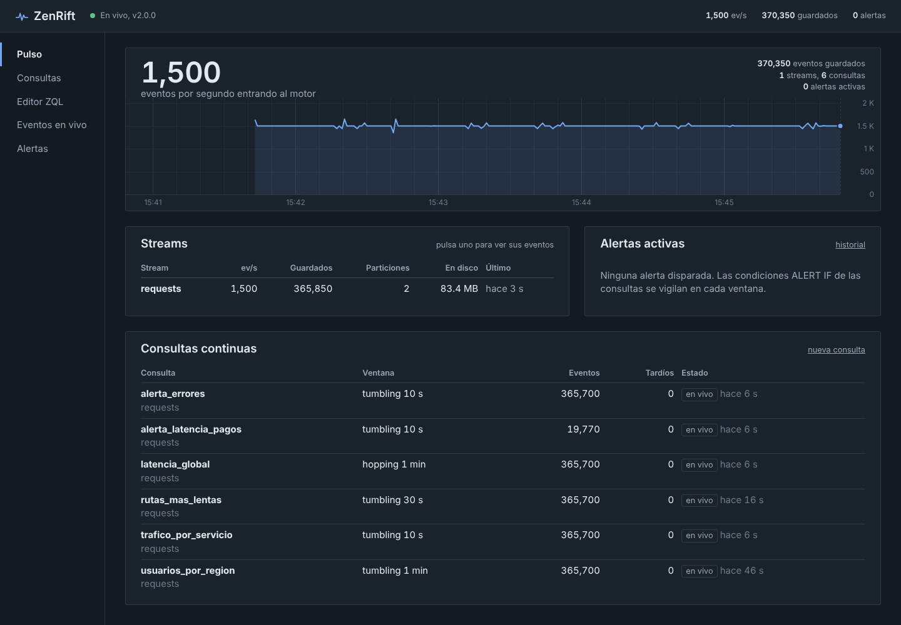

# Arquitectura

ZenRift es un único binario en C++20 sin dependencias externas: servidor HTTP,
almacenamiento, compilador de consultas, motor de ventanas y panel web. Este
documento explica cómo encajan las piezas y por qué están hechas así.

```
                    ┌────────────────────────── proceso zenrift ───────────────────────────┐
  POST /events ───► │  hilo de red (epoll/poll)                                            │
  SSE, REST    ◄─── │   parser HTTP incremental · router · SSE · panel embebido            │
                    │        │ lote crudo (sin analizar)            ▲ respuestas y eventos  │
                    │        ▼                                      │ (cola + waker)        │
                    │  ┌───────────┐  ┌───────────┐                 │                       │
                    │  │ shard 0   │  │ shard N   │  cada shard es dueño de sus particiones │
                    │  │ escáner   │  │           │  y de todo lo que les pasa:             │
                    │  │ log       │  │   ...     │  escanear, escribir, evaluar, tails     │
                    │  │ consultas │  │           │                                         │
                    │  └─────┬─────┘  └─────┬─────┘                                         │
                    │        │ paneles cerrados + marcas de agua                            │
                    │        ▼                                                              │
                    │  ┌──────────────────────────┐                                         │
                    │  │ coordinador              │  catálogo, fusión entre particiones,    │
                    │  │ finalizador · alertas    │  resultados, alertas, métricas          │
                    │  └──────────────────────────┘                                         │
                    └───────────────────────────────────────────────────────────────────────┘
                                 data/streams/<stream>/p<N>/<offset>.log   data/catalog.json
```

## Hilos y mensajes

Nadie comparte estado mutable. Hay tres tipos de hilo y todo cruza entre
ellos como mensaje por una cola:

- **Red** (el hilo principal): bucle de eventos sobre `epoll` (Linux), `poll`
  (otros Unix) o `WSAPoll` (Windows). Analiza peticiones, enruta y responde.
  No toca el motor: le entrega mensajes.
- **Shards** (núcleos − 1 por defecto): cada partición de cada stream tiene un
  único dueño. El shard hace todo lo que afecta a sus particiones, en orden y
  sin cerrojos: escanear lotes, escribirlos en el log, evaluar consultas,
  alimentar tails, releer el log para backfills, sincronizar a disco y aplicar
  la retención.
- **Coordinador**: dueño del catálogo (streams y consultas), de la
  finalización de ventanas, de las alertas y de las métricas.

Las colas (`core/mpsc_queue.hpp`) son de varios productores y un consumidor,
y el consumidor no saca mensajes de uno en uno: intercambia el vector interno
por uno vacío y procesa el lote entero. Los mensajes son de grano grueso (un
lote HTTP, un panel de ventana), así que un mutex por lote es despreciable y a
cambio la cola es trivialmente correcta y permite esperar con plazo. Las
respuestas vuelven al hilo de red por su propia cola más un *waker*
(`eventfd` en Linux, un par de sockets en el resto) que lo despierta de
`epoll_wait`.

Para enrutar una ingesta, el hilo de red lee una **tabla de enrutado**
inmutable (stream → particiones → shard) que el coordinador publica de nuevo
entera cada vez que cambia el catálogo (copy-on-write). Ingerir no pregunta
nada a nadie.

## El camino de un evento

1. El hilo de red recibe `POST /v1/streams/requests/events`. No analiza el
   JSON: mueve el cuerpo tal cual a un mensaje `Ingest` para el shard dueño de
   la siguiente partición (reparto por turnos entre lotes).
2. El shard lo pasa por el **escáner** (`engine/event_scanner.cpp`): una sola
   pasada que valida cada objeto (UTF-8 incluido), extrae la marca de tiempo y
   **solo los campos que usa alguna consulta o tail** de la partición. Cada
   clave se identifica por el hash de su ruta completa (`http.status`); si la
   ruta no es una hoja buscada ni prefijo de una, el valor se salta sin
   interpretarlo. Las cadenas sin escapes no se copian: son vistas al cuerpo.
3. Cada evento válido se añade al **log** de la partición; al final del lote,
   un `write` al sistema operativo.
4. Las consultas en vivo de la partición evalúan el lote desde memoria (los
   valores ya extraídos), y los tails filtran y reenvían.
5. El shard responde (`accepted`, `rejected`, offsets) a través de la cola del
   hilo de red.

## Almacenamiento

Cada partición es un log de solo-anexado dividido en segmentos
(`storage/partition_log.cpp`), nombrados por su offset base:

```
data/streams/requests/p0/00000000000000000000.log
data/streams/requests/p0/00000000000000524288.log

segmento = "ZRLOGv1\n" + registros
registro = u32 longitud | u32 crc32c(ts + payload) | i64 ts_ms | payload (JSON tal cual llegó)
```

- **Offsets implícitos**: base del segmento + posición. No hay archivo de
  índice que pueda desincronizarse; el índice disperso (una entrada cada
  ~4 KB) se reconstruye al abrir.
- **Recuperación**: al abrir se recorre cada segmento verificando el CRC32C de
  cada registro. Una cola rota por una caída (registro a medio escribir) se
  trunca y se avisa en el registro.
- **Durabilidad** (`fsync`): `interval` (por defecto) sincroniza cada
  `fsync_interval` (1 s): una caída del *proceso* no pierde nada confirmado,
  un corte de luz puede perder hasta un intervalo. `always` sincroniza antes de
  confirmar cada lote. `never` lo deja en manos del sistema operativo.
- **Retención** por tamaño y por antigüedad: se borran segmentos enteros,
  nunca el activo.
- **CRC32C** con la instrucción `crc32` de SSE4.2 cuando la CPU la tiene y
  *slicing-by-8* con tablas `constexpr` si no.

El catálogo (`data/catalog.json`) se reescribe de forma atómica (archivo
temporal + `fsync` + `rename`).

## Consultas: del texto al bytecode

`zql/` es un compilador pequeño:

1. **Lexer**: identificadores, cadenas, números y duraciones (`1h30m`) como un
   solo token. Las palabras clave se deciden por contexto en el parser, así
   `if(...)` es una función y `ALERT IF` una cláusula.
2. **Parser** de descenso recursivo con precedencia por niveles. Los errores
   llevan línea, columna y offset, y el editor los subraya.
3. **Compilador** (`zql/compiler.cpp`): resuelve alias, separa los ámbitos
   (evento: `WHERE`, claves, argumentos de agregación; fila: `SELECT`,
   `HAVING`, `ORDER BY`, `ALERT`), deduplica agregaciones por firma, pliega
   constantes, valida ventanas y produce un `QueryPlan` inmutable que se
   comparte entre hilos.
4. **VM de pila** (`zql/vm.cpp`): instrucciones de 8 bytes, lógica de tres
   valores, cortocircuito con saltos, conjuntos `IN` con hash y patrones
   `LIKE` precompilados. Hay una ruta rápida para la aritmética y las
   comparaciones entre números.

## Ventanas, paneles y marcas de agua

Una ventana deslizante de 1 minuto que avanza cada 10 s se descompone en
**paneles** de 10 s. Cada evento actualiza un solo panel; un resultado es la
fusión de los 6 últimos. Por eso todas las agregaciones son fusionables y nada
se recalcula desde los eventos.

En cada shard, una `PartitionQuery` (`engine/partition_query.cpp`) mantiene los
paneles abiertos de su partición, cada uno con una tabla hash de grupos cuyos
estados de agregación viven en un bloque contiguo de un arena. Su **marca de
agua** es el mayor tiempo de evento visto menos el `LATENESS`; cuando supera
el final de un panel, el panel se cierra y viaja al coordinador.

El **finalizador** (`engine/finalizer.cpp`, en el coordinador) junta los
paneles de todas las particiones y solo da una ventana por cerrada cuando la
marca de agua global —el mínimo de las particiones— la supera. Entonces
fusiona paneles, evalúa `SELECT`/`HAVING`, ordena, recorta, evalúa la alerta y
publica el JSON. Con `EMIT EVERY`, los shards envían además instantáneas de
sus paneles abiertos y el finalizador publica un resultado parcial.

Dos detalles de tiempo que evitan sorpresas:

- **Inactividad**: si una partición no recibe eventos durante `idle_timeout`,
  su marca de agua avanza con el reloj de pared. Sin esto, una partición
  callada bloquearía la marca de agua global para siempre.
- **Datos históricos**: si el tiempo de evento va más de un minuto por detrás
  del reloj de pared y el stream se queda en silencio, la marca de agua salta
  al presente en vez de avanzar ventana a ventana.

## Backfill, reinicios y exactitud

Cada consulta consume el log de cada partición como un **consumidor con
cursor**. Si se crea con `from: 1h` o `beginning`, empieza "atrasada": el shard
la alimenta releyendo el log en tandas de 2048 registros entre lote y lote (la
ingesta no se bloquea) y, cuando el cursor alcanza el final, la marca como en
vivo. A partir de ahí recibe cada lote nuevo solo si su cursor coincide con el
primer offset del lote, así que el paso de "releer" a "en vivo" no pierde ni
duplica eventos.

Al reiniciar, el estado de las ventanas no se guarda: se **reconstruye
releyendo el log** (como mucho `recovery_horizon`, 1 h). Las consultas `now`
guardan en el catálogo el offset de cada partición en el que se crearon y se
reanudan exactamente desde ahí, de modo que tras un reinicio cuentan lo mismo
que contaban antes, incluidos eventos con marcas de tiempo antiguas. Las
alertas también se recalculan: una alerta que seguía disparada vuelve a
aparecer como tal.

## Estructuras de datos propias

| Pieza | Dónde | Por qué |
|---|---|---|
| `FlatMap` | `core/flat_map.hpp` | tabla hash de direccionamiento abierto con Robin Hood, distancias en un byte aparte y borrado por desplazamiento hacia atrás (sin lápidas). Grupos de los paneles, rutas de campos, Space-Saving, HyperLogLog disperso, conjuntos `IN`. |
| `Arena` | `core/arena.hpp` | bump allocator por bloques: los grupos de un panel y sus claves viven en él y se liberan de una vez al fusionar el panel. El escáner usa otro por lote. |
| `MpscQueue` | `core/mpsc_queue.hpp` | cola por lotes descrita arriba. |
| hash | `core/hash.hpp` | estilo wyhash: multiplicación 64×64→128 y plegado; también para los hashes incrementales de rutas JSON. |
| `DDSketch` | `sketch/ddsketch.cpp` | cuantiles con error relativo garantizado (1 %); almacén disperso con pocas cubetas y denso después, con tope que colapsa las más bajas. |
| `HyperLogLog` | `sketch/hyperloglog.cpp` | p = 14, estimador de Ertl, modo disperso hasta 768 registros. |
| `SpaceSaving` | `sketch/space_saving.cpp` | top-k con montículo de mínimos indexado sobre un `FlatMap`. |
| Welford / Neumaier | `sketch/moments.hpp`, `engine/aggregate.cpp` | varianza y sumas estables y fusionables. |

Las medidas de cada pieza están en `zenrift_bench` (ver el README).

## Red

`net/` implementa HTTP/1.1 sobre sockets no bloqueantes:

- **Parser incremental** (`net/http.cpp`): admite peticiones partidas en
  cualquier punto, en tubería, cuerpos `chunked`, `Expect: 100-continue` y
  límites de cabeceras y cuerpo. Rechaza `Content-Length` y
  `Transfer-Encoding` a la vez.
- **Respuestas diferidas**: el handler marca la petición como pendiente y la
  respuesta del motor llega después por la cola; la conexión mantiene el orden
  aunque haya peticiones en tubería.
- **SSE con contrapresión**: si un cliente no lee y su búfer de salida supera
  el límite, se cierra su conexión en vez de acumular memoria. Los tails
  limitan además su ritmo en origen.
- **Panel embebido**: `cmake/embed.cmake` convierte `web/` en arrays de bytes
  dentro del binario, con su tipo MIME y un ETag (respuestas `304`).
  `--web-dir` sirve los archivos desde disco para desarrollar el panel sin
  recompilar; esas rutas se validan para no salir del directorio.

## Panel web

HTML, CSS y JavaScript sin frameworks ni paso de compilación: módulos ES
nativos, con tipos en JSDoc comprobados por TypeScript (`// @ts-check`).

```
web/js/
  main.js           arranque: barra superior, avisos, enrutado
  core/             dom (h()), formato, emisor de eventos, router por hash, toasts
  api/              cliente REST con token, EventSource con reconexión
  state/store.js    estado compartido alimentado por /v1/live
  charts/           lienzo nítido en HiDPI, escalas, registrador, líneas
  zql/              resaltado de sintaxis y ejemplos
  views/            pulso, consultas, editor, eventos en vivo, alertas
```

Las vistas tienen la misma forma (`mount(el, route)` y `unmount()`), se
suscriben al store y limpian sus suscripciones al salir. Las gráficas son
Canvas 2D dibujado a mano; leen la paleta de variables CSS, así que siguen el
tema claro u oscuro del sistema.



## Límites conocidos

- **Un solo nodo.** No hay replicación ni reparto entre máquinas: la
  disponibilidad es la de la máquina y su disco.
- **Estado de consultas en memoria.** Se reconstruye del log al arrancar, lo
  que tarda más cuanto mayor sea `recovery_horizon` y el tráfico.
- **Resultados en memoria**: se guardan las últimas `history` ventanas por
  consulta; para un histórico largo, consume `/v1/queries/{q}/stream` y
  guárdalo donde quieras.
- **Windows**: el código tiene sus rutas (`WSAPoll`, Winsock, archivos con la
  API de Win32), pero esta versión solo se ha compilado y probado en Linux.
