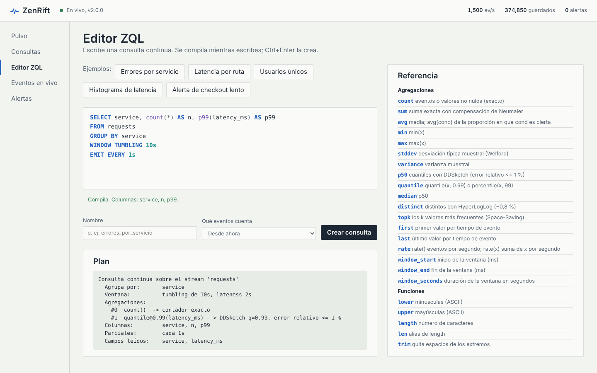

# ZQL: el lenguaje de consultas continuas

Una consulta ZQL se parece a un `SELECT` de SQL, pero no se ejecuta una vez:
queda viva dentro del motor y produce un resultado cada vez que se cierra una
ventana de tiempo. Cada resultado es una tabla pequeña (una fila por grupo).

```sql
SELECT service,
       count(*)                     AS peticiones,
       p99(latency_ms)              AS p99,
       avg(status >= 500) * 100     AS error_pct
FROM requests
WHERE method != 'OPTIONS'
GROUP BY service
WINDOW TUMBLING 10s LATENESS 2s
HAVING peticiones > 20
ORDER BY p99 DESC
LIMIT 10
EMIT EVERY 1s
ALERT IF error_pct > 5 AND peticiones > 30 FOR 2 WINDOWS
```

`zenrift check "<consulta>"` (o el editor del panel) compila la consulta sin
crearla y muestra su plan: qué campos lee, qué estructura usa cada agregación,
cuántos paneles tiene la ventana y el bytecode si se pide `--bytecode`.



## Estructura

```
SELECT <expr> [AS alias], ...
FROM <stream>
[WHERE <expr>]
[GROUP BY <expr>, ...]
[WINDOW TUMBLING <duración> | WINDOW HOPPING <duración> EVERY <duración>] [LATENESS <duración>]
[HAVING <expr>]
[ORDER BY <expr> [ASC | DESC], ...] [LIMIT <n>]
[EMIT EVERY <duración> | EMIT FINAL]
[ALERT IF <expr> [FOR <n> WINDOWS]]
```

Las cláusulas opcionales pueden ir en cualquier orden, pero cada una solo una
vez. Las palabras clave no distinguen mayúsculas. Se admiten comentarios
`-- hasta fin de línea` y `/* de bloque */`.

## Campos, valores y literales

| Escritura | Significado |
|---|---|
| `latency_ms` | campo de primer nivel del evento JSON |
| `http.status`, `tags.0` | ruta dentro de objetos y arrays (los índices empiezan en 0) |
| `"campo con espacios"`, `` `otro-campo` `` | nombres que no son identificadores simples |
| `'texto'` | cadena; una comilla se escribe duplicada: `'l''Hospitalet'` |
| `42`, `1.5`, `2e3` | números (siempre `double`) |
| `true`, `false`, `null` | literales |
| `10s`, `500ms`, `1h30m`, `7d` | duraciones (`ms`, `s`, `m`/`min`, `h`, `d`, `w`); valen milisegundos |

Un campo que no existe en el evento vale `null`. Un subobjeto o array completo
se puede seleccionar: su valor es el JSON tal cual (tipo `json`).

El escáner solo extrae los campos que usa alguna consulta o tail del stream: un
evento de 2 KB con 40 campos cuesta poco más que uno de 200 bytes si las
consultas leen 4.

## Expresiones

Precedencia, de menor a mayor:

| Nivel | Operadores |
|---|---|
| 1 | `OR` |
| 2 | `AND` |
| 3 | `NOT` |
| 4 | `=` `!=` `<>` `<` `<=` `>` `>=`, `IS [NOT] NULL`, `[NOT] IN (...)`, `[NOT] BETWEEN a AND b`, `[NOT] LIKE`, `[NOT] ILIKE` |
| 5 | `+` `-` `\|\|` (concatenación) |
| 6 | `*` `/` `%` |
| 7 | `-` unario |

Además: `CASE WHEN c THEN a [WHEN ...] [ELSE b] END`, llamadas a funciones y
paréntesis.

**Lógica de tres valores.** Como en SQL, una comparación con `null` es
desconocida (`null`), `null AND false` es `false` y `null OR true` es `true`.
`WHERE`, `HAVING` y `ALERT IF` solo dejan pasar lo que es **verdadero**.

**Conversión.** No hay conversiones implícitas: la aritmética con texto da
`null` (`'5' + 1` es `null`; usa `num('5') + 1`), `=` entre número y texto es
falso y `<`/`>` entre tipos distintos es `null`. Una división (o `%`) entre
cero da `null`. `avg(cond)` convierte `true`/`false` en 1/0,
así `avg(status >= 500)` es la proporción de errores.

**LIKE**: `%` cualquier secuencia, `_` un carácter; `ILIKE` ignora mayúsculas
(ASCII). `IN` usa un conjunto con hash, así que listas largas no penalizan.

Las expresiones constantes se pliegan al compilar (`60 * 1000` es un `60000`
en el bytecode) y `AND`/`OR` se evalúan en cortocircuito.

## Agregaciones

| Agregación | Resultado | Implementación | Error |
|---|---|---|---|
| `count(*)` | eventos de la ventana | contador | exacto |
| `count(x)` | valores no nulos | contador | exacto |
| `count(DISTINCT x)`, `distinct(x)` | valores distintos | HyperLogLog (p = 14, con modo disperso) | ~0,8 % típico; casi exacto con pocos valores |
| `sum(x)` | suma | suma compensada de Neumaier | exacto en la práctica |
| `avg(x)` | media | suma compensada / contador | exacto en la práctica |
| `min(x)`, `max(x)` | extremos | valor y marca de tiempo | exacto |
| `stddev(x)`, `variance(x)` | desviación y varianza muestrales | momentos de Welford (fusionables) | numéricamente estable |
| `p50(x)`, `p90`, `p95`, `p99`, `p999`, `median(x)` | cuantiles | DDSketch | ≤ 1 % relativo, publicado con 4 cifras |
| `quantile(x, 0.99)`, `percentile(x, 99)` | cuantil arbitrario | DDSketch | ≤ 1 % relativo |
| `topk(x, k)` | array `[{"value": …, "count": …}]` con los `k` más frecuentes | Space-Saving (8·k contadores, entre 64 y 1024) | cuenta sobrestimada como mucho en el error de su contador |
| `first(x)`, `last(x)` | primer / último valor por tiempo de evento | valor y marca de tiempo | exacto |
| `rate()`, `rate(x)` | eventos/s, o suma de `x` por segundo | contador / suma entre la duración | exacto |

Todas son **fusionables**: el estado de dos paneles o dos particiones se
combina sin perder garantías. Por eso una ventana deslizante de 1 hora que
avanza cada 10 s no vuelve a procesar eventos: fusiona 360 paneles.

Las agregaciones repetidas se calculan una vez: `count(*)` en `SELECT`,
`HAVING` y `ALERT` es un único contador.

En `SELECT` se puede operar con agregaciones y claves: `sum(bytes) / count(*)`,
`round(p99(latency_ms) / 1000, 2)`, `upper(service)`.

## Funciones

Texto: `lower`, `upper`, `length`/`len`, `trim`, `substr(s, inicio [, n])`
(desde 1), `split_part(s, sep, n)`, `replace(s, a, b)`, `concat(...)`,
`contains(s, sub)`, `starts_with`, `ends_with`.

Números: `abs`, `floor`, `ceil`, `round(x [, decimales])`, `sqrt`, `ln`,
`log10`, `log2`, `exp`, `pow`/`power`, `sign`, `least(...)`, `greatest(...)`,
`clamp(x, min, max)`, `bucket(x, ancho)` (redondea hacia abajo al múltiplo:
útil para histogramas con `GROUP BY bucket(latency_ms, 50)`).

Otras: `coalesce(...)`, `if(cond, a, b)`, `nullif(a, b)`, `str(x)`, `num(x)`,
`now()`.

De ventana (en `SELECT`, `HAVING`, `ORDER BY` y `ALERT`): `window_start()`,
`window_end()` (ms desde la época) y `window_seconds()`.

La lista viva está en `GET /v1/zql/functions` y en la referencia del editor.

## Ventanas y tiempo de evento

Cada evento tiene una marca de tiempo: el campo `ts` (o el que se configure
por stream) como número de época —en segundos, milisegundos, microsegundos o
nanosegundos: se detecta por magnitud— o como texto RFC 3339. Sin marca, se
usa la hora de llegada. Las ventanas se cuentan en **tiempo de evento**, no de
llegada: un evento de hace 3 s llega a la ventana de hace 3 s.

- `WINDOW TUMBLING 10s`: ventanas consecutivas sin solapar,
  `[00:00, 00:10)`, `[00:10, 00:20)`…
- `WINDOW HOPPING 1m EVERY 10s`: ventanas de 1 minuto que avanzan cada 10 s.
  Internamente son paneles de 10 s; cada resultado fusiona los 6 últimos.
  El tamaño debe ser múltiplo del avance (como mucho 720 paneles).
- Sin `WINDOW`: tumbling del tamaño por defecto (`window`, 10 s).

**Marca de agua y retrasos.** Cada partición lleva una marca de agua: el
mayor tiempo de evento visto menos `LATENESS` (2 s por defecto). Una ventana
se cierra cuando la marca de agua de todas las particiones la supera. Un
evento que llega para una ventana ya cerrada se descarta y se cuenta como
tardío (columna «Tardíos» del panel, `stats.late` en la API).

**Streams que se paran.** Si una partición no recibe eventos durante
`idle_timeout` (1 s), su reloj avanza con el reloj de pared, para que la
última ventana se cierre aunque no llegue nada más. Cuando el reloj de eventos
va muy por detrás del de pared (datos históricos, `from: beginning`), salta
hasta el presente en cuanto el stream queda en silencio.

**Ventanas vacías.** Una consulta con `GROUP BY` no produce nada en una
ventana sin eventos (no hay grupos). Una consulta global (sin `GROUP BY`) sí
produce su fila —`count(*)` = 0, `sum` = `null`—, porque «cero peticiones» es
justo lo que una alerta de caída necesita ver; tras 60 ventanas vacías
seguidas deja de emitirlas hasta el siguiente evento.

## Resultados parciales: `EMIT EVERY`

Por defecto una ventana solo se publica al cerrarse. `EMIT EVERY 1s` publica
además, cada segundo, el estado provisional de la ventana en curso
(`"partial": true`). El panel lo dibuja con trazo discontinuo. `EMIT FINAL` es
el comportamiento por defecto escrito explícitamente.

## Orden, límite y filtro de grupos

`HAVING` filtra filas del resultado y puede usar alias del `SELECT`.
`ORDER BY` acepta expresiones y alias; sin él, las filas salen ordenadas por
las claves de grupo. `LIMIT n` recorta cada resultado; sin `LIMIT`, el máximo
es `max_rows` (1000) y el resultado lleva `"truncated": true` si se recorta.

Para proteger la memoria, un panel admite como mucho `max_groups` grupos
(100 000): los eventos de grupos nuevos por encima del límite se descartan y
se cuentan en `stats.dropped`.

## Alertas: `ALERT IF`

```sql
ALERT IF p95 > 1200 AND n > 10 FOR 3 WINDOWS
```

La condición se evalúa en cada resultado final, por grupo (o una vez si la
consulta es global) y puede usar alias, agregaciones y claves. Una alerta se
**dispara** cuando la condición se cumple en `FOR n` ventanas seguidas (1 por
defecto) y se **resuelve** en la primera ventana en la que no se cumple, o en
la que su grupo deja de aparecer. Cada transición se publica en
`/v1/live` (evento `alert`), queda en `GET /v1/alerts` y aparece en el panel.

## Desde cuándo cuenta una consulta

Al crearla (`from` en `POST /v1/queries`, o el selector del editor):

| `from` | Cuenta |
|---|---|
| `now` (por defecto) | todo lo que llegue desde ahora, con cualquier marca de tiempo |
| `1h`, `24h`, … | relee el log: eventos con marca de tiempo de la última hora, día… |
| `beginning` | todo el log que conserve la retención |
| `2026-10-29T12:00:00Z` | eventos desde ese instante |

Una consulta que relee el log se pone al día a toda velocidad y después pasa a
vivo sin perder ni duplicar eventos. Tras un reinicio, cada consulta
reconstruye su estado releyendo el log (como mucho `recovery_horizon`, 1 h);
las consultas `now` se reanudan desde el offset exacto de cada partición en el
que se crearon.

## Ejemplos

Histograma de latencias por cubetas de 50 ms:

```sql
SELECT bucket(latency_ms, 50) AS desde_ms, count(*) AS n
FROM requests WHERE service = 'checkout'
GROUP BY bucket(latency_ms, 50)
WINDOW TUMBLING 1m
ORDER BY desde_ms
```

Usuarios únicos y rutas más visitadas por región, en una ventana deslizante:

```sql
SELECT region, distinct(user) AS usuarios, topk(route, 5) AS rutas
FROM requests
GROUP BY region
WINDOW HOPPING 5m EVERY 30s
```

Caída de tráfico (consulta global: también emite ventanas vacías):

```sql
SELECT count(*) AS n FROM requests
WINDOW TUMBLING 30s
ALERT IF n < 100 FOR 2 WINDOWS
```

Las 5 rutas más lentas que tengan tráfico suficiente:

```sql
SELECT route, p99(latency_ms) AS p99, count(*) AS n
FROM requests
GROUP BY route
WINDOW TUMBLING 30s
HAVING n >= 50
ORDER BY p99 DESC
LIMIT 5
```
